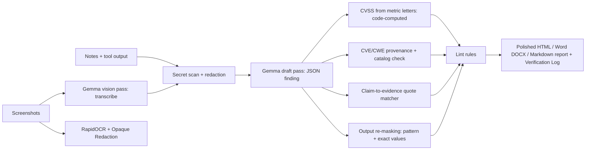
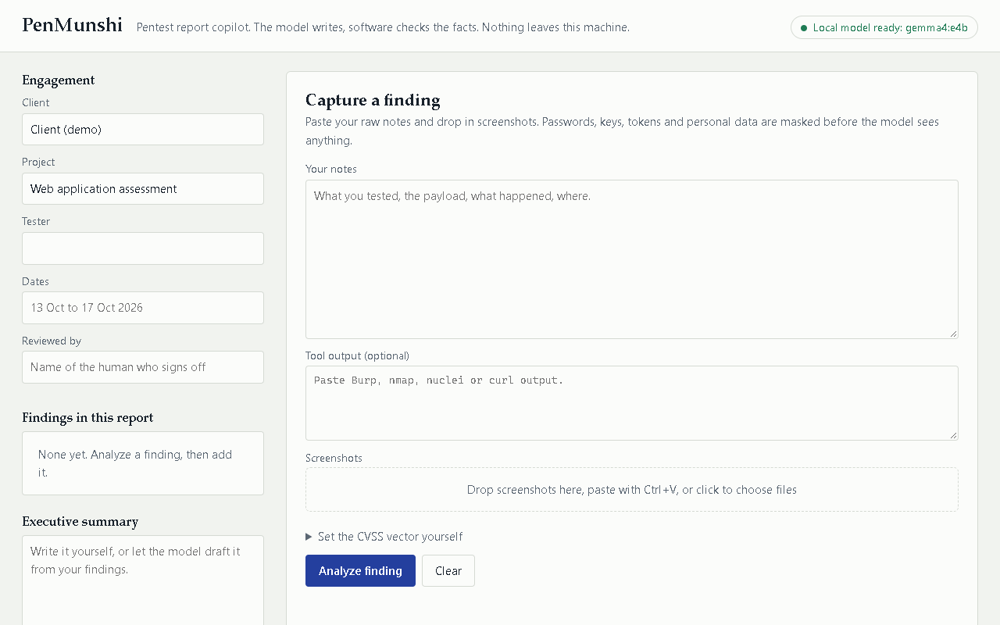
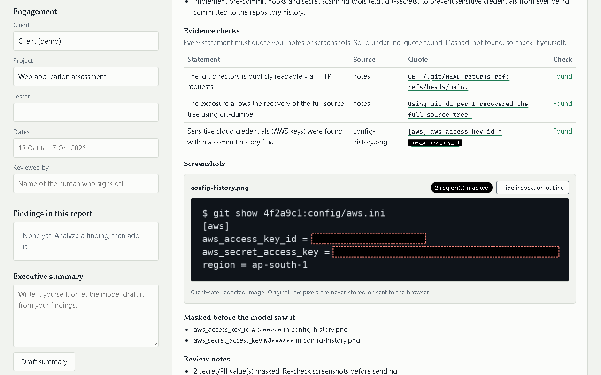
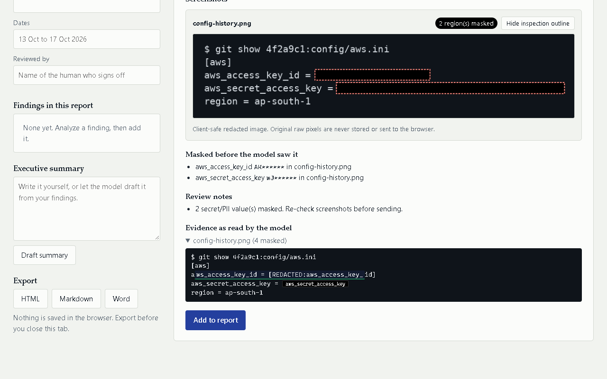
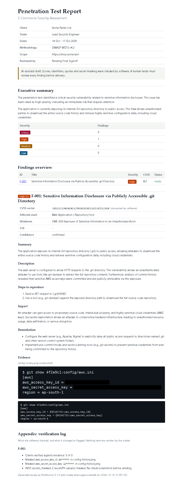

# PenMunshi 🖋️

**Offline-first pentest and VAPT report copilot.** A local Gemma 4 model drafts each finding from your raw notes and screenshots. Deterministic code owns every fact: CVSS maths, CVE/CWE identifiers, quotes, and secret masking. Client findings never leave your laptop.

> Built for DEV's Hacktoberfest Open-Source AI Challenge, Week 2 (Side Hustle). AI-assisted drafts must be reviewed by a human tester before delivery.

---

## At a glance

| What it does | Who it is for | Cost to run |
|---|---|---|
| Converts messy pentest notes, scanner outputs, and screenshots into client-ready VAPT reports (HTML, DOCX, Markdown, JSON). | Security consultants, bug bounty hunters, independent penetration testers, and internal red teams. | **$0 / token.** Runs 100% locally on a 6 GB consumer laptop GPU via Ollama. No cloud APIs, no subscriptions. |



### The core invariant: The model reads and writes; code owns the facts

| The model proposes | Code decides |
|---|---|
| **CVSS metric letters** (`AV`, `AC`, `PR`, `UI`, `S`, `C`, `I`, `A`) | The exact vector, score, and severity band (`cvss` library); a tester's manual override vector always wins. |
| **CVE and CWE ids** | CVEs survive only if explicitly written in your notes or scanner output; CWEs must exist in the curated catalog (canonical name substituted). |
| **Claims with quotes** | The quote must exist in your notes, tool output, or screenshot transcript with exact character offsets; unsupported claims receive dashed warnings. |
| **Sensitive free text** | Secrets are masked before reaching the model and again in output (regex patterns, Verhoeff/Luhn checksums for Aadhaar/cards, exact value cache). |
| **Screenshots** | RapidOCR extracts text boxes; sensitive spans are blacked out with Pillow opaque bars; a re-OCR loop verifies zero leakage before embedding. |
| **Executive summary** | Numbers are banned in model prose; counts are strictly rendered from the code-computed severity table. |

---

## Key Differentiators

### 1. In-browser Claim-to-Evidence Highlighting
Every factual statement drafted by the model references an evidence source and quote. In the local UI:
- **Clickable claim rows**: Clicking any claim smoothly scrolls the evidence panel directly to the quoted passage.
- **Visual verification**: Supported claims are marked with a solid green underline; unsupported claims display a dashed amber warning explaining `"Quote not found in evidence"`.

### 2. Screenshot Auto-Redaction with Re-OCR Verification
Client screenshots frequently leak credentials, bearer tokens, or PII:
- **Sub-span precision**: RapidOCR detects text regions; sub-span word offsets calculate tight bounding boxes.
- **Opaque blackout**: Pillow draws pure black rectangular bars with 4px safety margins (never blur or pixelate, which can be reversed).
- **Verification loop**: The redacted image is re-scanned with OCR. If any residual secret text survives, it automatically falls back to full-line blackout.
- **Interactive UI**: Testers can click `"Inspect mask boxes"` to see responsive SVG bounding box overlays.

### 3. Deterministic Scanner Importers
Stop writing reports from scratch. Import scanner results directly into structured finding folders:
```bash
penmunshi import scan.xml --format nmap -o findings/
penmunshi import burp_issues.xml --format burp -o findings/
```
Extracts targets, open ports, banners, and requests/responses into `notes.md` and `tool_output.txt`.

### 4. Retest Comparison Mode
When clients request a retest, compare the original assessment to the new assessment:
```bash
penmunshi retest old_report.json new_report.json
```
Deterministically matches findings by title and asset similarity, outputting a clear categorization:
`RESOLVED` (fixed), `OPEN` (persists), `REGRESSED` (worse severity or increased score), and `NEW`.

### 5. Agency-Grade DOCX and HTML Print CSS
- **Microsoft Word (DOCX)**: Dedicated cover page, clickable XML Table of Contents field (`TOC \o "1-3"`), running headers (`PenMunshi Security Assessment | Project`) and footers (`Confidential - Page X of Y`), plus shaded table headers and severity chips.
- **HTML Print**: Custom `@media print` CSS formatted for A4 PDF export with running page counters and clean page breaks before each finding.

---

## Real Benchmark Numbers

Evaluated on an **AMD Ryzen 5 6600H (6C/12T), 16 GB RAM, NVIDIA GeForce RTX 3050 6GB Laptop GPU (Windows 11)** running **Ollama 0.32.6** with local **`gemma4:e4b`** (7.5B Q4_K_M, Apache-2.0).

Full methodology, stability runs, and failure logs are documented unedited in [`docs/EVAL.md`](file:///c:/Users/Admin/Downloads/file4s/penmunshi-repo/penmunshi/docs/EVAL.md).

### Dev Split (22 cases, tested across 2 stability runs)

| Metric | dev (Run 1) | dev (Run 2) |
|---|---|---|
| Evaluation cases | 22 | 22 |
| Severity matches gold (code-computed) | 36% (8/22) | 32% (7/22) |
| Exact CVSS vector matches gold | 23% (5/22) | 23% (5/22) |
| Right CWE weakness found | 64% (14/22) | 64% (14/22) |
| Seeded secret kinds detected | **100%** | **100%** |
| Seeded secrets leaked into output | **0 (zero)** | **0 (zero)** |
| CVE identifiers hallucinated | **0 (zero)** | **0 (zero)** |
| Real claims supported by evidence quotes | **98% (48/49)** | **98% (48/49)** |
| Findings ready without human fix | **91% (20/22)** | **91% (20/22)** |
| Latency per finding (p50 / p95) | 55.4 s / 78.4 s | 57.5 s / 81.2 s |

### Held-Out Split (8 unseen cases, evaluated exactly 1 time)
Logged in `.penmunshi/heldout_runs.jsonl`:

| Metric | Held-Out Split |
|---|---|
| Evaluation cases | 8 |
| Severity matches gold | 50% (4/8) |
| Right CWE weakness found | 50% (4/8) |
| Seeded secret recall | **100%** |
| Secrets leaked into prompts or report | **0 (zero)** |
| CVE identifiers hallucinated | **0 (zero)** |
| Real claims supported by evidence quotes | **100% (18/18)** |
| Latency per finding (p50 / p95) | 58.0 s / 66.9 s |

---

## Honest Comparison with Existing Tools

We surveyed the closest tools currently available in the pentesting space:

| Tool | Deployment Model | Vision / Redaction | Verification Layer | Cost / Licensing |
|---|---|---|---|---|
| **PenMunshi** | **100% Local** (Ollama `gemma4:e4b`) | Local Gemma Vision + RapidOCR opaque masking | Code-owned CVSS maths, quote matcher, secret sanitizers | **Free / Open Source** (MIT code, Apache-2.0 weights) |
| [**Dradis Framework**](https://dradis.com/articles/self-hosted-ai-pentest-reporting.html) | Self-hosted or Cloud (includes local Ollama integration via Echo) | None (text only) | Prompt-based drafting; human must manually verify all text | Commercial SaaS / Enterprise ($79+/user/mo) |
| [**PentestReportAI**](https://www.pentestreportai.com/) | Cloud SaaS | None | Relies entirely on cloud LLM accuracy (OpenAI/Anthropic) | Commercial SaaS; requires uploading findings to third-party cloud |
| [**PlexTrac**](https://plextrac.com/) | Enterprise Cloud / On-Prem | Uploaded attachments | Platform workflow validations; AI features require cloud API | Enterprise pricing (custom annual contract) |

**Where PenMunshi wins**: True offline data sovereignty (zero packets leave your machine), multimodal screenshot analysis with automated OCR blackout, and a deterministic code verification layer with published failure logs.

---

## Quickstart

### Prerequisites
- Python 3.11+
- [Ollama](https://ollama.com/) installed and running (`ollama serve`)
- NVIDIA GPU with 6+ GB VRAM recommended (runs on CPU with slower generation)

### Installation
```bash
git clone https://github.com/YTxFSGAMERz/penmunshi && cd penmunshi
python -m venv .venv
# Windows:
.venv\Scripts\Activate.ps1
# Linux / macOS:
source .venv/bin/activate

pip install -e ".[dev]"
ollama pull gemma4:e4b
```

### 1. Check your setup
```bash
penmunshi doctor
```
Verifies Ollama connectivity, GPU hardware, and `gemma4:e4b` model availability.

### 2. Start the local Web UI
```bash
penmunshi serve --backend ollama
```
Open `http://127.0.0.1:8765` in your browser. Paste notes, drag-and-drop screenshots, and click **Analyze**.

### 3. CLI batch analysis
```bash
penmunshi analyze examples/acme-demo --backend ollama --out out/assessment
```
Generates `report.html`, `report.docx`, `report.md`, and `report.json`.

### 4. Scanner import & Retest
```bash
# Import Nmap or Burp XML findings
penmunshi import scan.xml -o findings/

# Compare retest against previous report
penmunshi retest old/report.json new/report.json
```

### 5. Build static demo site
```bash
penmunshi export-demo -o site/
```
Builds an offline recorded replay site suitable for static hosting on GitHub Pages or `.tech` domains.

---

## Screenshots

| Desktop Capture & Draft | Mask Box Inspection Overlay |
|---|---|
|  |  |

| Evidence Quote Highlighting | Agency-Grade HTML Report Export |
|---|---|
|  |  |

---

## Limits & Transparency

1. **OCR sensitivity**: RapidOCR detects standard terminal and browser text effectively, but low-contrast cursive or extreme aspect ratios can be missed. Always review masked images before sending.
2. **Curated CWE catalog**: PenMunshi ships with 107 vetted, high-frequency web CWE IDs. Niche hardware weaknesses are ignored unless added to `catalog.py`.
3. **Model hallucinations**: Gemma occasionally proposes optimistic CVSS metrics. This is why PenMunshi calculates the score strictly via the official CVSS v3.1 mathematical formulas in code.
4. **Single-user design**: The local server binds strictly to `127.0.0.1` without authentication. It is intended for individual testers on their workstation, not shared multi-tenant hosting.

---

## Responsible Use

For authorized security assessments and penetration testing only. Never test systems without explicit written permission. Demo fixtures in this repository use fictional targets (`shop.acme.test`) and standard public AWS documentation sample credentials.

---

## License

Code is licensed under the **MIT License** (`LICENSE`).
Gemma 4 model weights are released by Google under the **Apache-2.0 License**.
