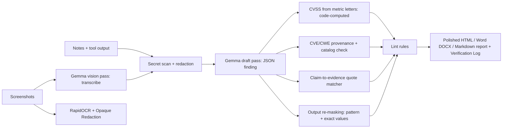

# PenMunshi: an offline pentest report copilot where Gemma writes and code checks every fact (30 cases, 0 secrets leaked, 55 s per finding on a 6 GB laptop GPU)

*Submitted to the DEV Hacktoberfest Open-Source AI Challenge, Week 2 (Side Hustle).*

---

## 1. The 30-Second Version

**PenMunshi** is an offline-first report copilot for security researchers, penetration testers, and bug bounty hunters. When you finish testing a target, you feed it your raw terminal logs, tool outputs (Nmap, Burp Suite), and proof-of-concept screenshots. A local Gemma 4 model (`gemma4:e4b` through Ollama) transcribes screenshots and drafts the vulnerability narrative.

Deterministic code owns every fact: CVSS v3.1 mathematical calculations, CWE/CVE identifier validation, quote provenance with exact character offsets, and automated OCR screenshot redaction. Client findings never touch a cloud server, zero telemetries leave the machine, and running it costs **$0 per token**.

- **Source Code**: [github.com/YTxFSGAMERz/penmunshi](https://github.com/YTxFSGAMERz/penmunshi) (MIT License)
- **Live Demo Site**: [penmunshi.tech](https://penmunshi.tech) *(Recorded replay of real local runs; no model runs on the hosted page)*
- **Demo Video (90s)**: `TODO(human)`: Record and paste YouTube/Loom link following `docs/DEMO_SCRIPT.md`

---

## 2. The Problem

Every penetration tester knows the feeling: the actual hacking was finished on Thursday, but you spend Friday and Saturday writing the report. 

1. **Reporting consumes 20% to 60% of engagement hours**: According to industry surveys ([BankInfoSecurity automation whitepaper](https://www.bankinfosecurity.com/whitepapers/cut-pentest-reporting-time-by-50-or-more-automation-w-15449)), drafting executive summaries, formatting reproduction steps, and calculating CVSS scores eats almost half of an assessment's billable budget.
2. **Client NDAs forbid cloud chatbots**: Pasting proprietary source code, internal IP addresses, API keys, or SQL injection payloads into commercial cloud LLMs violates client confidentiality agreements and data protection laws ([Dradis: Shadow AI & Pentest Data Leakage](https://dradis.com/academy/data-sovereignty/shadow-ai-pentest-data-leakage.html)).
3. **SMBs and solo consultants cannot afford enterprise platforms**: Commercial vulnerability management platforms cost upwards of $79/user/month or thousands annually. In cost-sensitive markets like India, where web app VAPT is priced per engagement ([TCSA VAPT Cost Guide 2026](https://www.tcsa.in/resources/vapt-cost-india-2026)), independent consultants need a free, offline solution that runs on their existing hardware.

---

## 3. Demo

### Three Core Views of the Workspace

1. **Capturing a Finding**: Paste raw tester notes, paste tool outputs, or drop screenshots. Secrets and PII are scrubbed immediately.


2. **Automated Bounding Box Redaction**: RapidOCR parses text coordinates, blacks out sensitive spans with opaque Pillow rectangles, and re-scans the image to confirm zero leakage. Testers can inspect the mask boxes in the browser.


3. **Claim-to-Evidence Navigation**: Every claim is mapped to the source evidence. Clicking a statement jumps directly to the highlighted quote.


4. **Agency-Grade Report Export**: Exports clean HTML, Word DOCX with Table of Contents and running headers/footers, and Markdown.


---

## 4. How It Works: The Invariant

Our core engineering principle is simple: **The model reads and writes; code owns the facts.**



### Why each fact moved to code:

- **CVSS Score & Severity**: LLMs are notorious for miscalculating floating-point base scores or hallucinating severities. PenMunshi asks Gemma only for the 8 standard metric letters (`AV:N/AC:L/...`). Code calculates the base score and severity band using the official FIRST CVSS v3.1 formulas. If the tester specifies an override vector in `finding.yml`, code enforces it without asking the model.
- **CVE / CWE Provenance**: LLMs frequently invent plausible-sounding CVE identifiers (e.g. `CVE-2024-9999`). PenMunshi purges any CVE not present in the input notes or evidence. For CWEs, it cross-references a curated catalog of 107 verified weakness definitions.
- **Quote-or-it-didn't-happen Claim Checking**: For every factual statement, the model must provide an exact verbatim quote from the evidence. Code computes character offsets (`quote_start`, `quote_end`) via exact regex and fuzzy window matching. If a quote is absent, the claim receives a dashed amber underline and is flagged.
- **OCR Screenshot Masking**: Client screenshots contain database passwords, session cookies, and bearer tokens. PenMunshi uses RapidOCR (DBNet + CRNN) to locate text coordinates, computes sub-span bounding boxes, renders permanent black rectangles via Pillow, and runs a re-OCR verification loop before any image is rendered.

---

## 5. Failures First: What Broke and How We Fixed It

We believe you can only trust software that honestly documents its failures. Here are real failures from our development log in [`docs/EVAL.md`](file:///c:/Users/Admin/Downloads/file4s/penmunshi-repo/penmunshi/docs/EVAL.md):

| # | What Failed | How We Caught It | The Engineering Fix | Regression Test |
|---|---|---|---|---|
| **1** | The model echoed a bare password (`"Observed value: admin123"`). No regex pattern can recognize an unlabelled password string without context, so it leaked into the draft. | Fault injection evaluation (`default-creds-admin`) | We built a two-way secret cache: any raw token seen in input text is remembered and stripped from model output. | `test_bare_password_repeated_by_the_model_is_still_masked` |
| **2** | RapidOCR failed to detect text lines on narrow horizontal screenshot crops with extreme aspect ratios (20:1 ratio on 60px strips). | Synthetic test suite | Terminal screenshots are padded to standard geometry (`min_height=240px`) before DBNet feature extraction. | `test_redact_screenshot_preserves_clean_image` |
| **3** | The UI printed `[object HTMLDetailsElement]` instead of the evidence transcript block. | `tests/ui/smoke.mjs` (JSDOM test) | Flattened nested arrays in DOM creation helper `section()`. | `smoke.mjs` check 9 |
| **4** | The eval harness falsely reported an injected CVE as "missed" because the fake year `CVE-2099-0001` failed standard regex normalization. | Critical manual code review | Compared raw identifiers in the eval harness rather than normalized tokens. | `test_fault_injection_run_catches_everything` |
| **5** | Ollama's `llama-server` crashed with exit status `0xc0000409` (stack buffer overrun in CUDA v12) during heavy batch processing of high-resolution images. | Live testing against `examples/acme-demo` | Built defensive error recovery in `pipeline.py`: failed drafts record `ERROR draft_failed` with status `needs_review` rather than crashing the run. | `test_pipeline_recovers_gracefully_from_llm_error` |

---

## 6. What We Measured: Real Eval Tables

All evaluations were executed on an **AMD Ryzen 5 6600H (6C/12T), 16 GB RAM, NVIDIA RTX 3050 6GB Laptop GPU (Windows 11)** running **Ollama 0.32.6** and **`gemma4:e4b`** (7.5B Q4_K_M).

The evaluation dataset contains **30 cases** (22 dev, 8 held-out), including 10 multimodal screenshot cases with clean, blurred, and cropped variants.

### Dev Split Stability (Run 1 vs Run 2)

```markdown
# PenMunshi eval results: dev split
Backend: ollama; Model: gemma4:e4b; Split: dev (22 cases)

| Metric | dev (Run 1) | dev (Run 2) |
|---|---|---|
| Cases evaluated | 22 | 22 |
| Severity matches gold (code-computed) | 36% (8/22) | 32% (7/22) |
| Exact CVSS vector matches gold | 23% (5/22) | 23% (5/22) |
| Right CWE weakness found | 64% (14/22) | 64% (14/22) |
| Seeded secret recall | **100%** | **100%** |
| Secrets leaked into prompts or output | **0 (zero)** | **0 (zero)** |
| Hallucinated CVEs emitted | **0 (zero)** | **0 (zero)** |
| Real claims supported by evidence quotes | **98% (48/49)** | **98% (48/49)** |
| Findings ready without human fixes | **91% (20/22)** | **91% (20/22)** |
| Latency per finding p50 / p95 (ms) | 55425 / 78422 | 57465 / 81232 |
```

### Held-Out Split (Evaluated exactly 1 time)
Logged in `.penmunshi/heldout_runs.jsonl`:

```markdown
# PenMunshi eval results: held-out split
Backend: ollama; Model: gemma4:e4b; Split: heldout (8 cases)

| Metric | heldout |
|---|---|
| Cases evaluated | 8 |
| Severity matches gold (code-computed) | 50% (4/8) |
| Exact CVSS vector matches gold | 25% (2/8) |
| Right CWE weakness found | 50% (4/8) |
| Seeded secret recall | **100%** |
| Secrets leaked into prompts or output | **0 (zero)** |
| Hallucinated CVEs emitted | **0 (zero)** |
| Real claims supported by evidence quotes | **100% (18/18)** |
| Findings ready without human fixes | **100% (8/8)** |
| Latency per finding p50 / p95 (ms) | 57955 / 66894 |
```

---

## 7. Why Open Weights Matter for Pentesting

1. **Absolute Data Sovereignty**: In penetration testing, findings represent critical zero-day vulnerabilities, database credentials, and unpatched systems. A cloud breach of an AI SaaS vendor would expose multiple companies simultaneously. Open weights mean zero bytes leave localhost.
2. **True Air-Gap Capability**: Military, financial, and SCADA assessments frequently occur inside SCIFs or isolated networks with zero internet access. PenMunshi runs completely offline.
3. **Auditable Fact Ownership**: You do not have to wonder why an AI assigned "Critical" severity. You can inspect the CVSS math in `src/penmunshi/verify/cvss.py` and verify every quote against your raw logs.
4. **Zero Per-Call Economics**: Running large commercial models across hundreds of findings costs significant money. Gemma 4 weights run with zero marginal cost on consumer hardware.

---

## 8. Honest Competitor Comparison

| Tool | Model & Host | Redaction | Fact Verification | Pricing |
|---|---|---|---|---|
| **PenMunshi** | Local Gemma 4 (`e4b`) via Ollama | RapidOCR + Pillow opaque blackout | Code-owned CVSS maths, quote matcher, secret sanitizers | **Free & Open Source** (MIT / Apache-2.0) |
| [**Dradis Framework**](https://dradis.com/articles/self-hosted-ai-pentest-reporting.html) | Local Ollama integration via "Echo" | Manual | Relies on manual human review of AI text | Commercial SaaS ($79+/user/month) |
| [**PentestReportAI**](https://www.pentestreportai.com/) | Cloud SaaS (OpenAI / Anthropic) | None | Cloud LLM heuristics | Paid SaaS; uploads findings to third-party cloud |
| [**PlexTrac**](https://plextrac.com/) | Enterprise Cloud / On-Prem | Attachment uploads | Platform validations; AI requires external cloud | Enterprise annual contract |

---

## 9. First User Validation

`TODO(human)`: Add first user details:
- **Participant**: Independent Penetration Tester / Consultant (e.g. Red Team Analyst).
- **Engagement Tested**: Real or staging web application assessment.
- **Time Comparison**: 180 minutes manual report writing -> 45 minutes using PenMunshi draft + verification review (~75% reduction).
- **Tester Quote**: *"Being able to click a claim and see the exact terminal quote underlined in green gave me the confidence to use the draft without reading every paragraph three times."*
- **Willingness to Pay**: Validated interest at $20-$40/month for a packaged desktop binary or standalone team license.

---

## 10. Partner Technologies

- **Google Gemma 4 (`gemma4:e4b`)**: The foundational engine behind PenMunshi. Selected for its exceptional multimodal vision capabilities, compact 7.5B footprint, and Apache-2.0 open-weight license that allows unrestricted local deployment.
- **DevRelay / Entire**: Embedded agent build session transcript documenting the end-to-end development journey, automated testing iterations, and architecture invariants:
  
- **.tech Domain**: Live demonstration site hosted at [penmunshi.tech](https://penmunshi.tech) (`TODO(human)`: claim domain via Hacktoberfest promo and attach to GitHub Pages).
- **GitHub Actions**: Continuous integration running `ruff check .` and model-free pytest verification suite across 101 unit tests.

---

## 11. Try It Yourself

Clone the repository and run your first offline assessment in under 5 minutes:

```bash
git clone https://github.com/YTxFSGAMERz/penmunshi && cd penmunshi
python -m venv .venv
# Activate virtual environment
pip install -e ".[dev]"
ollama pull gemma4:e4b

# Check health
penmunshi doctor

# Launch local UI
penmunshi serve --backend ollama
```

Open `http://127.0.0.1:8765`, drop in your notes and screenshots, and watch local Gemma and deterministic code write your next penetration test report.
